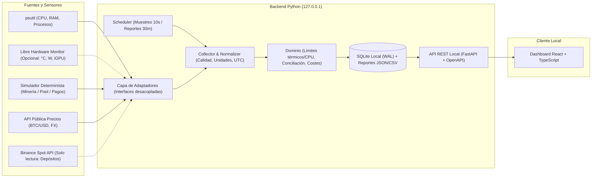

# Arquitectura propuesta y validada (Fase 0)

## Decisiones iniciales acordadas
- **Frontend:** React + TypeScript (SPA servida localmente; requiere instalar Node.js LTS antes de Fase 7).
- **Backend/colección inicial:** Python (`>=3.12`, verificado `3.13.14` en el entorno) con API REST local (FastAPI + Uvicorn).
- **Telemetría:** `psutil` para CPU/RAM/procesos; Libre Hardware Monitor (LHM) como adaptador opcional desacoplado (`http://127.0.0.1:8085/data.json` o WMI `root\LibreHardwareMonitor`).
- **Almacenamiento inicial:** SQLite (`sqlite3 3.50.4` integrado en Python) en modo `WAL` (Write-Ahead Logging), con claves foráneas activas y migraciones versionadas.
- **Minería:** proveedor simulado determinista primero (`SimulatedMinerPoolAdapter`).
- **Pool/Binance:** proveedor de pool pendiente de decisión del usuario (teniendo en cuenta el cierre oficial de Binance Pool en noviembre de 2026); Binance Exchange se integrará únicamente en modo lectura (`GET /sapi/v1/capital/deposit/hisrec`) mediante `ExchangeReadOnlyAdapter`.
- **Seguridad de red:** Dashboard y API ligados exclusivamente a `127.0.0.1` por defecto.
- **Reportes automáticos:** cada 30 minutos (configurable), calculados sobre ventanas UTC cerradas.
- **Android:** opcional y posterior al MVP de PC (Fase 11).

## Diagrama de componentes y flujo

## Componentes
1. **Collector**: toma muestras periódicas sin bloquear el hilo de la API, adjunta calidad (`measured`, `estimated`, `unavailable`, `simulated`), unidad y procedencia (`source`).
2. **Domain**: modelos inmutables y reglas de negocio (políticas de parada por límite de temperatura/CPU/tiempo, separación de estados financieros, cálculo de energía y conciliación); no conoce detalles HTTP ni SQL.
3. **Storage**: SQLite local con modo `WAL` para permitir lecturas concurrentes de la API mientras el Collector escribe series temporales; migraciones SQL numeradas e idempotencia por claves naturales.
4. **Adapters**: contratos explícitos (`SensorAdapter`, `MinerAdapter`, `PoolAdapter`, `PriceAdapter`, `ExchangeReadOnlyAdapter`) con implementaciones reales y simuladas/mock.
5. **API**: endpoints REST locales documentados con OpenAPI y esquemas Pydantic validados.
6. **Scheduler**: ejecución periódica con timeout por tarea, manejo de errores aislados (un fallo en LHM o Binance no detiene el muestreo de `psutil`) y reintentos con backoff exponencial acotado.
7. **Dashboard**: aplicación React + TypeScript que consume exclusivamente la API local.
8. **Reporting**: generador de resúmenes analíticos cada 30 minutos (persistidos en SQLite y exportables a JSON/CSV).

## Flujo de datos
Sensores/adaptadores -> normalización y etiquetado de calidad -> validación de dominio y límites de seguridad -> almacenamiento transaccional SQLite -> API REST -> dashboard y reportes de 30 minutos.

## Comportamiento ante sensores ausentes
No se asume que todos los sensores existen. Si temperatura (`cpu_temp_c`, `gpu_temp_c`), potencia (`cpu_package_power_w`) o energía (`energy_consumed_wh`) no están disponibles (por ejemplo, cuando LHM no está instalado o en ejecución), el adaptador emite explícitamente:
- `value = null`
- `status = "unavailable"`
- `quality_note = "<motivo explícito de ausencia>"`

Nunca se sustituye un sensor ausente por `0.0` ni se estima temperatura o consumo en vatios a partir del porcentaje de uso de CPU.

## Restricciones arquitectónicas
- La UI nunca consulta directamente SQLite ni servicios externos (todo pasa por la API local).
- Todas las integraciones externas son reemplazables por implementaciones `fake`/`simulated`.
- La aplicación debe seguir funcionando con normalidad si no hay GPU dedicada, sensores de temperatura/potencia, conexión al pool o credenciales de Binance.
- Todos los timestamps se almacenan y procesan en **UTC** (`ISO-8601` con sufijo `Z` o `+00:00`); la conversión a hora local ocurre únicamente en la capa de presentación del Dashboard.
- Prohibido mezclar métricas o recompensas con `status="simulated"` y datos reales en sumatorias o reportes sin filtro explícito.
- No ejecutar minería real durante la Fase 0 ni iniciar procesos de minería sin acción y confirmación explícita del usuario.

## Modelo de medición
Cada medición incluye:
- `metric_name`: identificador estable en `snake_case`.
- `value`: número real o `null` cuando no está disponible.
- `unit`: unidad explícita (`%`, `MiB`, `MHz`, `°C`, `W`, `Wh`, `H/s`).
- `status`: `measured` | `estimated` | `unavailable` | `simulated`.
- `source`: origen exacto (`psutil`, `lhm_http`, `lhm_wmi`, `win32_perf`, `calculation`, `simulator:<escenario>`).
- `observed_at_utc`: timestamp UTC ISO-8601.
- `quality_note`: explicación opcional sobre límites, degradación o ausencia del sensor.

## Estados de recompensa y pago (Separación estricta)
1. `estimated_reward` (`RewardSnapshot.status = "estimated"` o `"simulated"`): cálculo teórico local según shares aceptadas.
2. `pool_balance_pending` (`RewardSnapshot.status = "pool_reported"`): saldo acumulado reportado por la API del pool aún no liquidado.
3. `payout_issued` (`PaymentEvent.event_type = "payout_issued"`): pago emitido por el pool hacia una dirección externa o factura Lightning.
4. `exchange_deposit` (`PaymentEvent.event_type = "deposit_detected"`): depósito efectivamente detectado y acreditado en Binance vía API de solo lectura (`GET /sapi/v1/capital/deposit/hisrec`).

Jamás se inferirá que un pago llegó a Binance solo porque el pool informe haberlo emitido.
